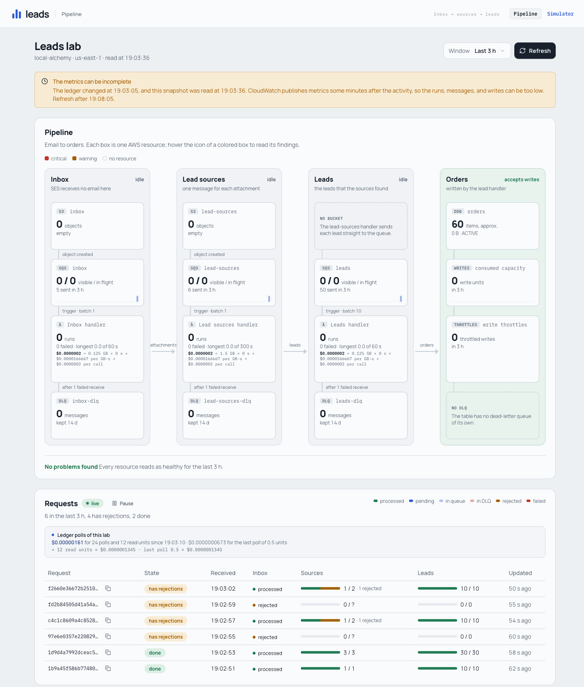
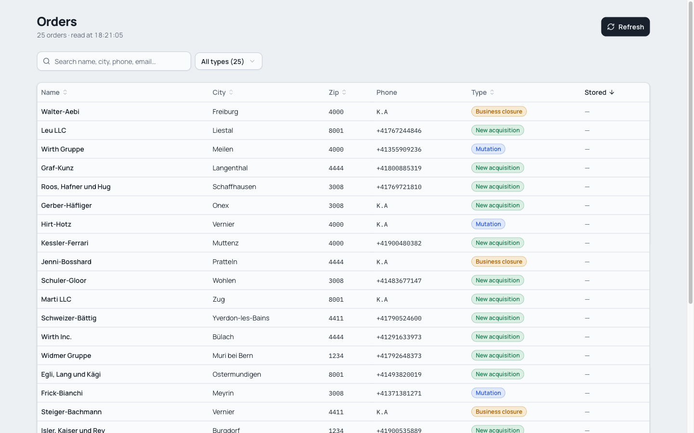
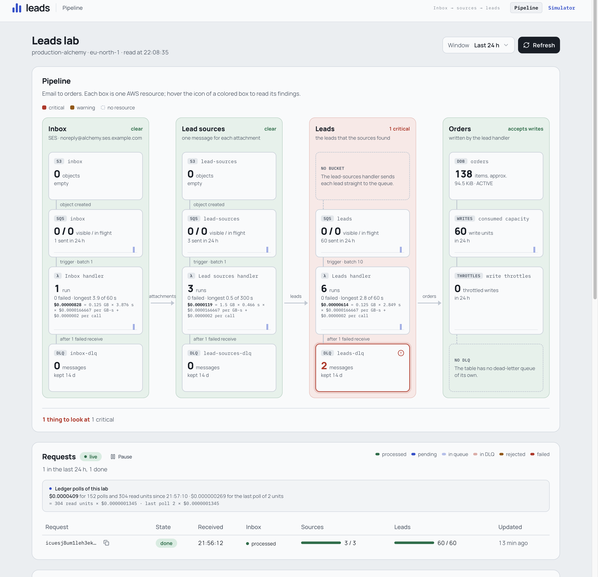
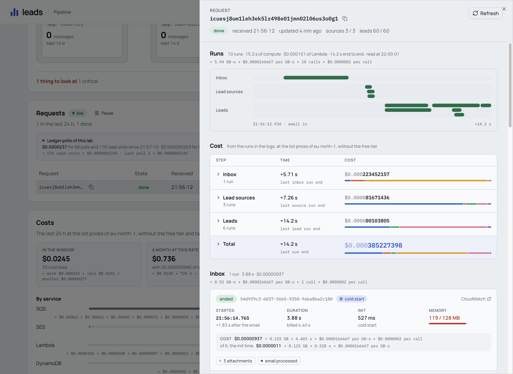
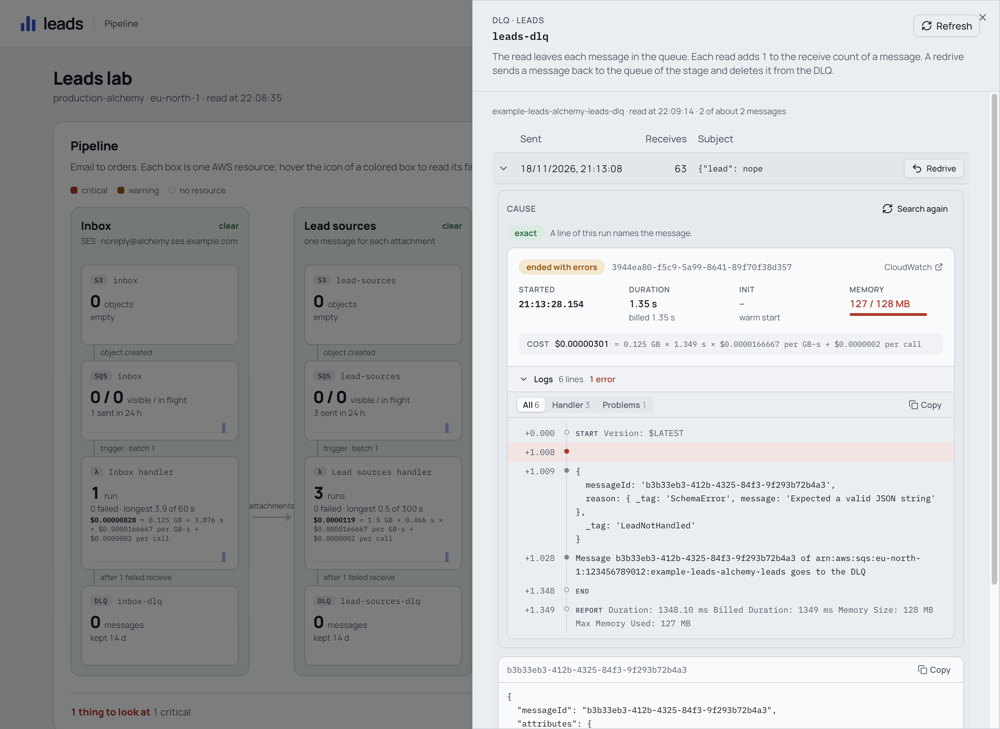
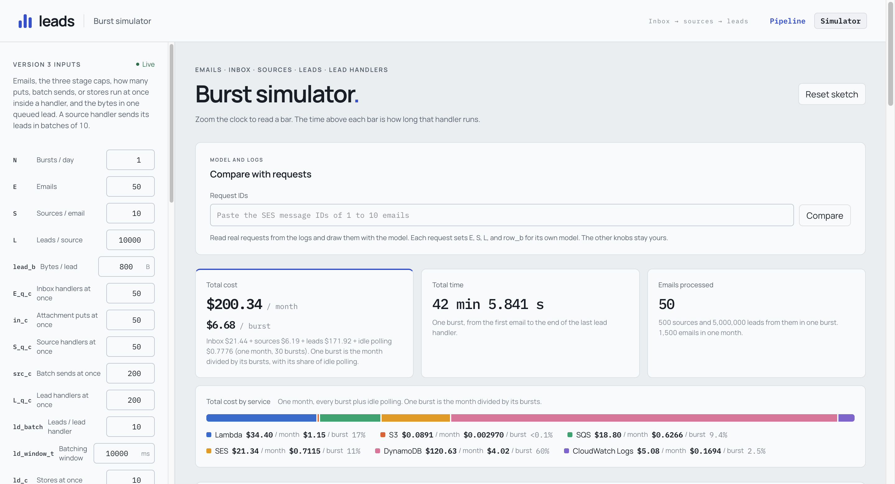
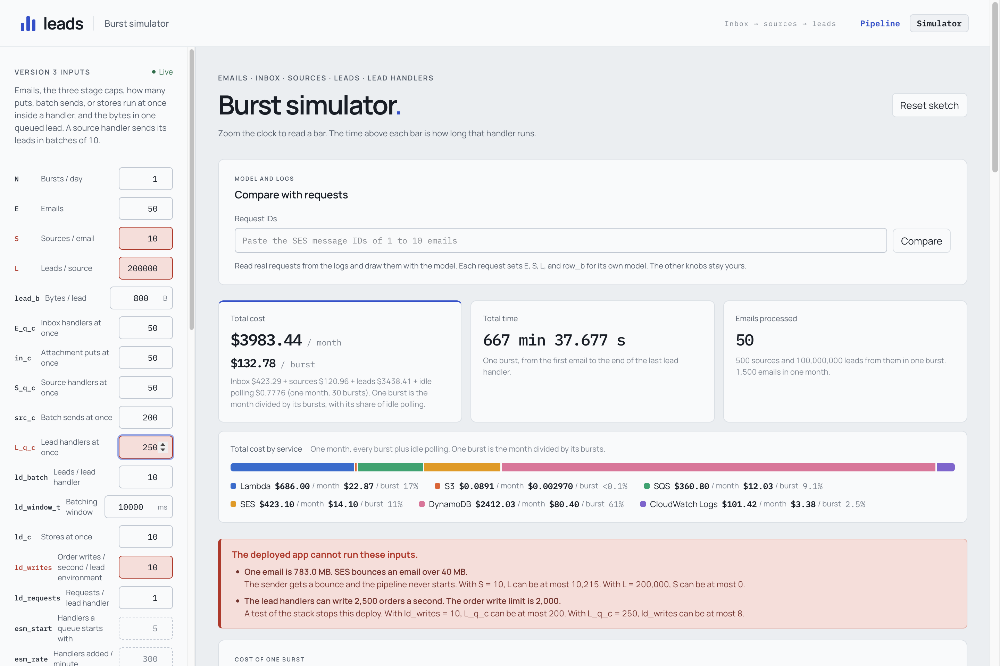
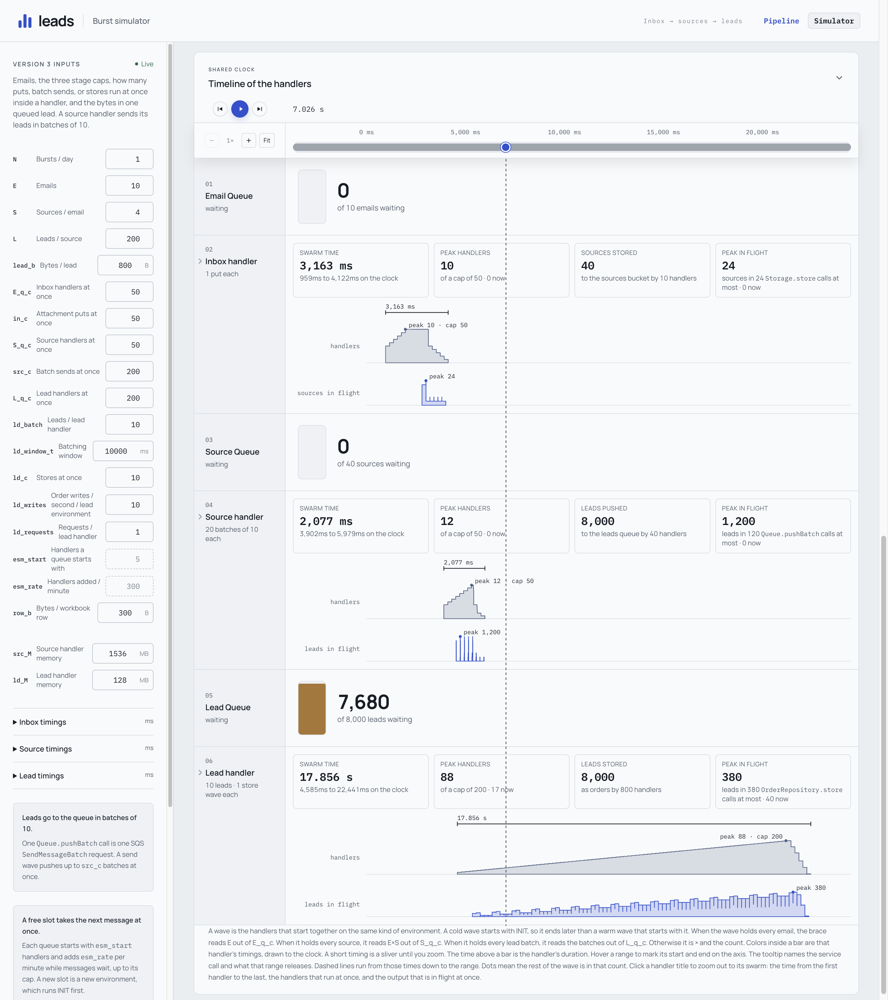
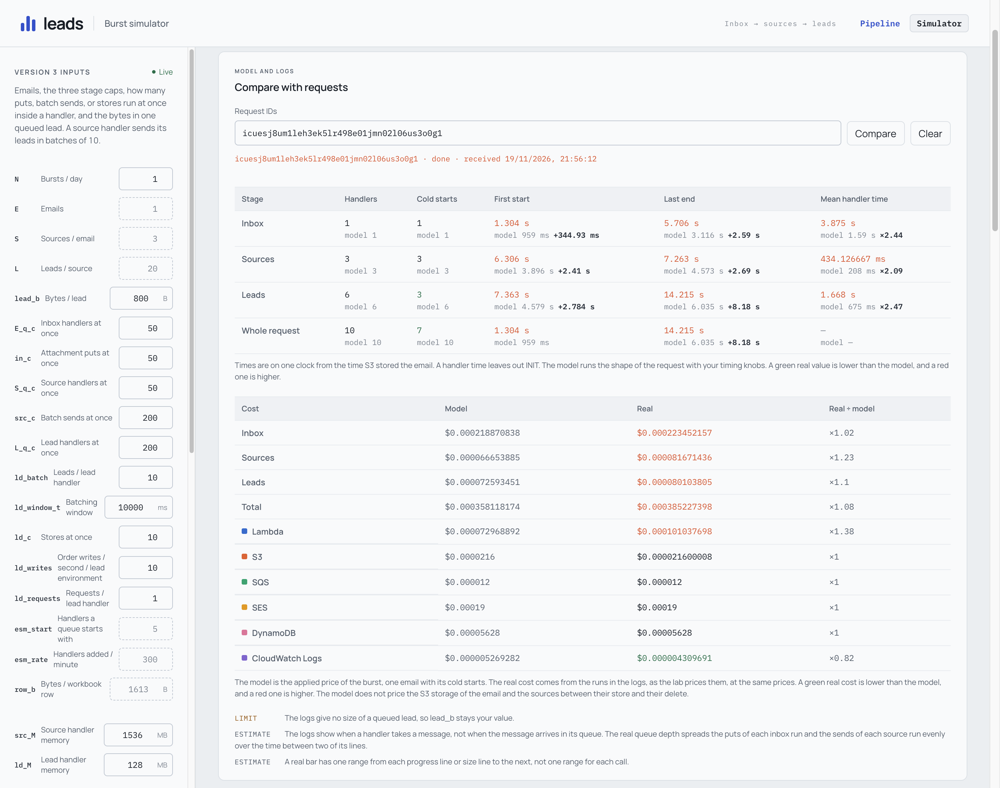
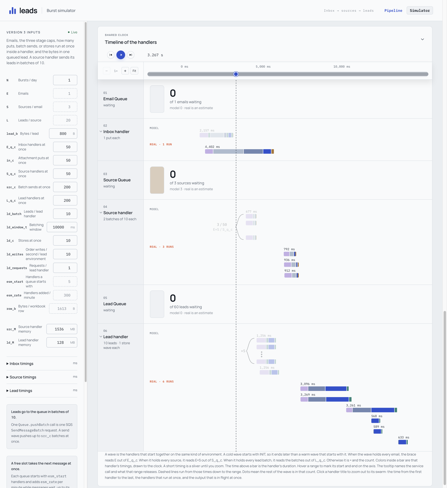

# Effect Email Lead Pipeline

[](https://github.com/ChubbyDuck/effect-email-lead-pipeline/actions/workflows/ci.yml)

**A production-shaped [Effect 4](https://effect.website) reference architecture:** an event-driven AWS serverless pipeline that turns inbound emails with Excel workbooks into idempotent DynamoDB orders, paired with a live observability **Lab**, a **Burst Simulator**, an **Orders dashboard**, and side-by-side **AWS CDK** and **Alchemy 2** (Effect-native IaC) stacks — all runnable locally in Docker with no AWS account.

> This is a public teaching and showcase repository built independently from a real-world pipeline architecture. It holds no employer code.

**Stack at a glance:** Effect 4 · TypeScript 7 (`@effect/tsgo`) · AWS SES, S3, SQS, Lambda, DynamoDB, AppConfig · Alchemy 2 & AWS CDK · TanStack Start + React 19 + shadcn/ui · Turborepo + pnpm · Floci (local AWS) · Vitest · Oxlint + Oxfmt

<picture>
  <source media="(prefers-color-scheme: dark)" srcset="docs/images/diagrams/pipeline-dark.svg">
  
</picture>

*Read from top left: **blue** is AWS infrastructure, **green** is our Effect handlers, and **red** is where failed messages wait in dead-letter queues. No stage calls the next directly — each stage scales, retries, and fails independently.* ([Watch the 38-second animated walkthrough →](docs/images/pipeline.mp4))

---

## Why this repository exists

Most Effect examples stop at 50-line toy scripts. Real systems have messy inputs, partial batch failures, duplicate deliveries, rate limits, live runtime config, graceful shutdowns, and infrastructure that must agree with application schemas.

Clone and explore this repo to see concrete, tested answers to questions like:

- **How do you structure a multi-app Effect codebase?** Hexagonal architecture (*one hexagon per app, one shared kernel*) with import boundaries enforced by Oxlint.
- **How do you model real failure modes in Effect?** Separating domain *rejections*, transient *failures*, unexpected *defects*, and Lambda shutdown *interruptions*.
- **How do you parse messy real-world files with `Schema`?** Coercing dirty Excel cells into typed leads with content-derived SHA-256 idempotency keys.
- **How do you share one schema between runtime code and AWS infrastructure?** Compiling an Effect `Schema` into a JSON Schema Draft-04 validator for AWS AppConfig *and* layering live AppConfig polling over env vars with `ConfigProvider`.
- **How do you bound concurrency and rate-limit distributed Lambda writes?** `Effect.partition`, jittered exponential `Schedule`, `Ref`, and `RateLimiter` from `effect/persistence` as a Layer decorator.
- **How do you test Effect use cases fast and exhaustively?** Partial mocks via `Layer.mock`, deterministic time with `TestClock`, mid-flight `Fiber.interrupt`, and visual Mermaid variant trees — zero AWS, zero sleeps, zero mocking libraries.
- **How does Effect-native IaC compare to AWS CDK?** The exact same pipeline deployed by both `iac/alchemy` (built on Effect 4) and `iac/cdk` from one shared contract.

### Jump to a section

1. [Try it locally in 3 minutes](#try-it-locally-in-3-minutes) — run the tests and the entire AWS pipeline on your machine.
2. [The real-world scenario](#the-real-world-scenario) — domain language, stage flow, security, and failure outcomes.
3. [Inside the Lab: Monitor, Burst Simulator, and Comparison](#inside-the-lab-monitor-burst-simulator-and-comparison) — live pipeline observability, DLQ forensics, wave simulation, and real-vs-model validation.
4. [Effect 4 showcase: 8 real patterns](#effect-4-showcase-8-real-patterns) — annotated excerpts straight from the codebase.
5. [Architecture at a glance](#architecture-at-a-glance) — hexagons, enforced boundaries, packages, and the two web apps.
6. [15-minute guided code tour](#15-minute-guided-code-tour) — the exact files to read in order if you are new here.
7. [Four-level test pyramid](#four-level-test-pyramid) — from pure fake-port unit tests to full-stack E2E with fault injection.
8. [Deployments, AWS setup, and reference](#deployments-aws-setup-and-reference) — deploying to real AWS and deep operational specs.

---

## Try it locally in 3 minutes

**Prerequisites:** Node 24 ([`.nvmrc`](.nvmrc)) and pnpm 12 for unit tests; Docker and the AWS CLI to run the full pipeline locally via [Floci](https://hub.docker.com/r/floci/floci) (a local AWS emulator — no AWS account needed).

### 1. Verify the codebase (no Docker required)

```sh
pnpm install
pnpm typecheck && pnpm lint && pnpm test
```

Unit tests run every use case on fake Effect layers (`Layer.mock` + `TestClock`), so they finish quickly without Docker. `pnpm test` also verifies the production builds of both web apps.

### 2. Boot the entire pipeline locally

```sh
pnpm floci:alchemy:up                              # Start Floci on port 4568
DEPLOYMENT=local-alchemy pnpm infra:deploy:floci   # Deploy the stack with Alchemy into Floci
pnpm catalog --deployment local-alchemy            # Generate test emails & Excel workbooks
DEPLOYMENT=local-alchemy pnpm lab:local            # Start the Lab on http://localhost:4780
```

In a second terminal, drop a realistic test email into the inbox bucket (this simulates SES delivering a real email):

```sh
cd tools/generator
AWS_ACCESS_KEY_ID=test AWS_SECRET_ACCESS_KEY=test aws s3 cp \
  output/catalog/2-inbox-bucket/A2-01--owner-dmarc-pass.eml \
  s3://leads-local-alchemy-inbox/A2-01--owner-dmarc-pass.eml \
  --endpoint-url http://127.0.0.1:4568 --region us-east-1
```

Watch the email flow through all three Lambda stages live in the **Lab** (`http://localhost:4780`), then start the **Orders dashboard** to browse the resulting DynamoDB orders on `http://localhost:4790`:

```sh
DEPLOYMENT=local-alchemy pnpm dashboard:local
```

> **Want to break things on purpose?** Open `tools/generator/output/catalog/README.md` (generated by `pnpm catalog`) for dozens of ready-to-copy scenarios: forged `From` headers, failed DMARC checks, broken workbooks, 100k-row stress tests, malformed SQS payloads, and DLQ redrive cases. Run `pnpm floci:alchemy:down` when done to remove the emulator and its state.
>
> *Why `local-alchemy`?* Alchemy provisions AppConfig via the AppConfig API, so the real Lambda bundles read live runtime settings inside Floci. Floci's CloudFormation engine does not materialize AppConfig resources for `local-cdk` ([details below](#floci-notes)).

### The two web apps watching the pipeline

| The Lab (`apps/lab`, `:4780`) | The Orders Dashboard (`apps/dashboard`, `:4790`) |
| --- | --- |
|  |  |
| Internal observability & modeling app: live queue depths, handler runs, per-request AWS cost breakdowns, automated DLQ cause detective, one-click redrive, and an interactive **Burst Simulator** that overlays real CloudWatch runs against a mathematical wave model. | User-facing read-only app: searches, filters, sorts, and paginates stored DynamoDB orders with a short-TTL Effect cache. |

---

## The real-world scenario

Business partners send emails with attached Excel spreadsheets (`business_closure`, `new_acquisition`, and `mutation` formats — up to 100,000+ rows per workbook). Every valid row must become exactly one stored **Order** in DynamoDB, even under bursts, malformed files, transient AWS outages, or duplicate deliveries.

### Life of one request

1. **Ingress (SES → Inbox S3 → Inbox SQS):** SES writes the raw `.eml` object to the inbox bucket; S3 publishes a notification to the inbox queue.
2. **Inbox handler (`HandleInbox`):** Acknowledges the request in the **Request ledger**, reads and parses the MIME email, verifies the sender via **Guard** (exact whitelist + single `From` header + topmost SES `Authentication-Results` DMARC `pass` aligned with the sender's domain), and writes each attachment to the sources bucket using conditional S3 puts (`IfNoneMatch: '*'`) so redrives never emit duplicate downstream events.
3. **Source handler (`HandleLeadSources`):** Reads one workbook, detects which of the three schema formats matches its header row, sanitizes cells, hashes each row into a deterministic SHA-256 `idempotencyKey`, logs any bad rows without aborting valid siblings, and publishes valid leads to the leads queue in batches of 10 (retrying only the unaccepted subset of a batch).
4. **Lead handler (`HandleLead`):** Consumes up to 10 leads per invocation, enforces a stack-wide **Order write limit** (2,000 writes/s via a per-environment token bucket), and writes each lead to DynamoDB with `ConditionExpression: 'attribute_not_exists(idempotencyKey)'` so resends and redrives are strictly idempotent. Failed leads return in SQS `batchItemFailures` without affecting successful siblings.

### Three handler outcomes

Every inbox and source handler ends in one of three explicit outcomes (enforced centrally by [`withHandlerOutcome`](packages/pipeline/src/Core/Pipeline/Application/outcome.ts)):

| Outcome | When it happens | S3 file | SQS message |
| --- | --- | --- | --- |
| **processed** | All work succeeded. | Deleted (status lives in the ledger) | Acknowledged |
| **rejected** | Permanent input error a redrive cannot fix (bad MIME, unauthorized sender, unknown workbook header, zero valid rows). | Deleted + logged as error | Acknowledged |
| **failed** | Transient infrastructure failure (after retries) or unexpected defect. | Preserved in bucket | Routed to the stage DLQ for redrive |

### Core domain language

The codebase, tests, and docs share a strict ubiquitous language defined in [`CONTEXT.md`](CONTEXT.md):

| Term | Meaning |
| --- | --- |
| **Email** | One inbound MIME message with zero or more attachments. |
| **Source** | One Excel workbook extracted from an email (one message on the sources queue). |
| **Lead** | One validated row from a source (one message on the leads queue). |
| **Order** | A lead stored in DynamoDB, keyed by its content-derived `idempotencyKey`. |
| **Request** | The end-to-end work triggered by one email, identified by its SES message ID. |
| **Request ledger** | DynamoDB table tracking each request's inbox status and pending/processed/rejected/failed counts across stages. |
| **Handler** | One Lambda invocation of a stage (1 email, 1 source, or 1 batch of up to 10 leads). |
| **Stage cap** | Maximum concurrent handlers for a stage (50 inbox, 50 sources, 200 leads). |
| **Deployment** | One complete, isolated copy of the pipeline made by one IaC tool (`local-alchemy`, `production-cdk`, etc.). |

---

## Inside the Lab: Monitor, Burst Simulator, and Comparison

The **Lab** ([`apps/lab`](apps/lab), `http://localhost:4780`) is a full TanStack Start internal workbench that watches one deployment at a time (real AWS or local Floci). The screenshots below come from a real **`production-alchemy`** deployment on AWS (`eu-north-1`); the exact same Lab works identically against **`production-cdk`** (reading CloudFormation instead of Alchemy state) and local Floci deployments.

It is built around two hexagons — **Observation** and **Simulation** — exposed as two pages that reinforce each other: the **Monitor** (`/`) observes the real pipeline, the **Burst Simulator** (`/simulator`) models it mathematically, and **Comparison** overlays real CloudWatch runs directly on top of the model.

### The Monitor (`/`) — Live pipeline observability & DLQ forensics

The Monitor separates cheap live state from on-demand CloudWatch reads: the **Request ledger** streams continuously, while CloudWatch snapshots load on page open, window change (`1 h`, `3 h`, `6 h`, `12 h`, `24 h`), or explicit Refresh — and warns you when recent activity is still inside CloudWatch's ~5-minute metric publishing delay.



*Live Monitor on `production-alchemy`: real CloudWatch invocation counts, sparklines, and per-handler Lambda cost formulas alongside the red `1 critical` alert on `leads-dlq` (`2 messages`) and the live Request ledger below (complete with metered DynamoDB scan RCUs for the Lab's own polling).*

- **Pipeline flow & automated health assessment ([`health.ts`](apps/lab/src/Core/Observation/Domain/health.ts)):** Draws the live topology (buckets, queues, handlers, DLQs, Orders table) with a single unified severity verdict (`ok` / `info` / `warning` / `critical`). Flags failed or in-progress deployments (reading either CloudFormation for CDK or Alchemy's DynamoDB state), disabled queue triggers, throttled invocations, Lambda runs exceeding 80% of their timeout, S3 objects stuck longer than 15 minutes, queue backlogs older than 5 minutes, and any message waiting in a DLQ.
- **Live Request ledger over SSE ([`/api/requests`](apps/lab/src/routes/api/requests.ts)):** Polls DynamoDB every 2 seconds via `WatchRequests` and streams changes to the browser over Server-Sent Events with pause/resume controls. Even instruments the DynamoDB client with scan-metering middleware ([`services.server.ts`](apps/lab/src/Entrypoints/Lab/services.server.ts)) so the UI reports the exact Read Capacity Units consumed by the Lab's own polling.
- **Per-request execution sheet ([`RequestSheet.tsx`](apps/lab/src/UI/RequestSheet.tsx)):** Click any request to open a slide-over sheet showing a cross-stage timeline of its real Lambda invocations (including cold-start `INIT` markers), every stage's CloudWatch log lines, observed file sizes, and an exact per-request AWS cost breakdown computed from the shared [`billing.ts`](packages/shared/src/Core/Shared/Domain/billing.ts) rules.
- **DLQ inspector, automated cause detective & one-click redrive ([`DlqSheet.tsx`](apps/lab/src/UI/DlqSheet.tsx), [`ReadDeadLetterCause`](apps/lab/src/Core/Observation/Application/UseCases/ReadDeadLetterCause/handler.ts)):** Click any stage DLQ to inspect dead-lettered messages as JSON and send individual messages back to their main queue (automatically watching queue/bucket counts until the redriven work settles). Opening a DLQ row searches CloudWatch Logs in three escalating steps to pinpoint the failed run:
  1. **Certain match:** a run whose logs name the exact `messageId`,
  2. **Request match:** a failed run for a `requestID` carried by the message, nearest the receive time,
  3. **Time-window match:** any failed or timed-out run (`ERROR`, `Task timed out`, `Status: error/timeout`) near the receive window.
- **Window costs & tabbed resource inspector:** Summarizes observed AWS spend across the selected window alongside tabbed detail views for **Handlers**, **Queues**, **Buckets**, **Logs**, **Runtime settings** (the active AppConfig document), and **Stack** status.

| Per-request run timeline, cold starts & AWS cost | DLQ inspector, 3-step Cause Detective & one-click redrive |
| --- | --- |
|  |  |
| One completed 3-workbook email (`60 / 60` leads): 10 Lambda runs on a `14.2 s` end-to-end timeline, exact per-stage AWS cost split (`$0.000385` total), and cold-start `INIT 527 ms` / memory breakdown per invocation. | Clicking `leads-dlq` inspects dead-lettered messages without deleting them; expanding a row automatically finds the `exact` CloudWatch run — showing Effect's `LeadNotHandled` + `SchemaError` right next to the **Redrive** button. |

### The Burst Simulator (`/simulator`) — Capacity, wave & cost modeling

Before changing concurrency caps, memory, batching windows, or rate limits in production, you can stress-test the pipeline mathematically in the **Burst Simulator** ([`docs/simulator-layout.md`](docs/simulator-layout.md)) — initialized directly from the same `@leads/shared` settings that CDK and Alchemy deploy.

| Monthly & per-burst AWS cost projections (50 emails · 5M leads) | Automated AWS & stack limit guardrails |
| --- | --- |
|  |  |
| Live knobs in the left rail drive instant end-to-end duration (`42 min 5.8 s`), burst & monthly AWS spend (`$6.68 / burst`, `$200.34 / month`), and per-service cost splits (`DynamoDB 60%`, `Lambda 17%`, `SES 11%`, `SQS 9.4%`). | Pushing `L = 200,000` and `L_q_c = 250` highlights the offending knobs in red and computes exact safe ceilings: SES's 40 MB bounce limit (`L ≤ 10,215`) and the stack's 2,000 writes/s limit (`L_q_c ≤ 200`). |

- **Six synchronized lanes on one clock:** Models a burst of emails flowing through six stacked lanes — **Emails tank**, **Inbox handlers**, **Sources queue tank**, **Source handlers**, **Leads queue tank**, and **Lead handlers** — scrubbed by one shared timeline cursor with Play/Pause (8-second playback), Start/End, drag-to-pan, and up to `256×` Ctrl+wheel zoom.
- **Waves, internal handler phases & queue tanks:** Groups concurrent Lambda invocations into **waves** bounded by stage caps (`E_q_c`, `S_q_c`, `L_q_c`) and SQS event source mapping ramp-up (`esm_start`, `esm_rate`). Each bar is painted down to its individual internal steps — cold-start `INIT`, ledger writes, S3 reads/puts, parsing, SQS batch sends, token-bucket waits, DynamoDB stores, and deletes — while hovering shows exact step durations and release counts, and the tanks show live queue depth at the cursor.
- **Interactive knobs mapped to real config:** Tune burst shape (`N` bursts/day, `E` emails, `S` sources/email, `L` leads/source, row & lead byte sizes), stage caps, AppConfig internal concurrencies (`in_c`, `src_c`, `ld_c`), lead batch size/window, per-environment write limit (`ld_writes`), Lambda memory, and per-step timings.
- **Automatic AWS & stack limit guardrails ([`limits.ts`](apps/lab/src/Core/Simulation/Domain/limits.ts)):** Continuously validates your knob combination against real deployment constraints and calculates the exact safe ceiling whenever a limit breaks:
  - **SES 40 MB bounce limit** (reports maximum `L` rows or `S` workbooks per email),
  - **Cold-start Lambda timeouts** for inbox (1 min), source (5 min), and lead (1 min) handlers,
  - **Token-bucket starvation** when waiting for order-write tokens pushes a lead handler past its timeout,
  - **Stack order-write ceiling** (`L_q_c × ld_writes > 2,000 writes/s`),
  - **SQS 1 MiB batch payload ceiling** (`min(L, 10) × lead_b`).
- **Warm, burst, monthly & idle cost projections ([`burstCharges.ts`](apps/lab/src/Core/Simulation/Domain/burstCharges.ts)):** Uses the exact same `@leads/shared` billing formulas and AWS prices as the Monitor to project per-email warm ("pure") cost, full-burst ("applied" with cold starts) cost, monthly spend at `N` bursts/day, and per-service cost splits across SES, S3, SQS, Lambda, DynamoDB, and CloudWatch.



*Shared-clock timeline scrubbed to `7.026 s` (`10` emails × `4` sources × `200` leads = `8,000` leads): each stage shows its SQS event-source-mapping ramp-up curve, peak concurrency against its stage cap, in-flight AWS call bursts, and live queue tanks (`7,680 of 8,000 leads waiting`).*

### Comparison — Real CloudWatch runs vs. the model

Paste one or up to 10 real `requestID`s from the Monitor into the Simulator (`CompareRequest` / `ReadComparisons`) to calibrate the model against production or Floci reality:

- **Single-request overlay ([`comparison.ts`](apps/lab/src/Core/Observation/Domain/comparison.ts)):** Locks the workload shape knobs (`E = 1`, observed `S`, mean `L`, mean `row_b`) from the real request's logs while keeping your timing knobs, then draws a **real-run lane** directly beneath each **modeled lane** on the same clock (starting from S3 email arrival). Compares handler counts, cold starts, latencies, durations, and real vs. modeled AWS cost side by side.
- **Multi-request summary ([`comparisonSummary.ts`](apps/lab/src/Core/Observation/Domain/comparisonSummary.ts)):** Compares each request against its *own* shape's model first, then aggregates median, mean, min, and max real-to-model ratios across stages and AWS services — automatically excluding still-active, incomplete, or truncated requests from the aggregate while still showing their individual numbers.

| Real vs. Model stage & AWS cost comparison | Real CloudWatch runs overlaid beneath modeled waves |
| --- | --- |
|  |  |
| Pasting a real `production-alchemy` request ID auto-locks `E = 1`, `S = 3`, `L = 20`, `row_b = 1,613 B` and compares every stage and AWS service — modeled total cost `$0.000358` vs. real `$0.000385` (`×1.08`). | Real CloudWatch runs painted step-by-step directly beneath the modeled wave braces (`3 / 50`, `×5`) — visibly distinguishing `3` cold-start lead invocations (`~3.1 s`) from `3` warm container reuses (`~0.6 s`). |

---

## Effect 4 showcase: 8 real patterns

Every snippet below is taken directly from this repository (Effect `4.1.4`). Click the file link under each pattern to inspect the complete implementation and its tests.

### 1. Hexagonal ports as `Context.Service`, errors that never lose their cause

Each external dependency is a pure port interface in `Core/*/Ports/` using Effect 4's `Context.Service` and `Data.TaggedError`. Every error keeps the original failure untouched in a `readonly reason: unknown` field so callers narrow the error channel without hiding root causes:

```ts
// packages/pipeline/src/Core/Pipeline/Ports/Storage.ts
export class FileNotStored extends Data.TaggedError('FileNotStored')<{
  readonly file: File;
  readonly reason: unknown;
}> {
  override get message(): string {
    return withReason(`File was not stored in a bucket: ${this.file.bucket} with key: ${this.file.key}`, this.reason);
  }
}

export class Storage extends Context.Service<
  Storage,
  {
    readonly store: (file: File) => Effect.Effect<void, FileNotStored>;
    readonly delete: (bucket: string, key: string) => Effect.Effect<void, FileNotDeleted>;
    readonly read: (bucket: string, key: string) => Effect.Effect<File, FileNotRead>;
    readonly storeOrSkip: (file: File) => Effect.Effect<StoreOrSkipResult, FileNotStored>;
  }
>()('@leads/pipeline/Core/Pipeline/Ports/Storage') {}
```

Because use cases only `yield* Storage` (never importing `@aws-sdk/*`), the Lambda composition root plugs in real AWS layers (`Layer.mergeAll(...)`) while unit tests plug in fakes.

*Read more:* [`Storage.ts`](packages/pipeline/src/Core/Pipeline/Ports/Storage.ts) · [`Storage/live.ts`](packages/pipeline/src/Infrastructure/Pipeline/Storage/live.ts) · [`Lambda/services.ts`](apps/lambda/src/Entrypoints/Lambda/services.ts)

---

### 2. Typed rejections vs. failures vs. defects vs. interruption

This is where Effect's error model pays for itself. Look at the flow of `HandleInbox`:

<picture>
  <source media="(prefers-color-scheme: dark)" srcset="docs/images/diagrams/inbox-handler-dark.svg">
  
</picture>

[`withHandlerOutcome`](packages/pipeline/src/Core/Pipeline/Application/outcome.ts) classifies every possible exit in ~25 lines — with full type safety on the `rejections` list (`readonly E['_tag'][]`):

```ts
// packages/pipeline/src/Core/Pipeline/Application/outcome.ts
return yield* work.pipe(
  Effect.andThen(() => end(options.ended('processed'))),
  // 1. Expected rejections: log, mark rejected, fall through to delete & ack
  Effect.catchIf(
    (e) => options.rejections.includes(e._tag),
    (e) => Effect.logError(e).pipe(Effect.andThen(() => end(options.ended('rejected'))))
  ),
  // 2. Clean up processed or rejected S3 files; a delete error is only a warning
  Effect.andThen(() =>
    storage.delete(options.file.bucket, options.file.key).pipe(
      Effect.retry(retryPolicy(config)),
      Effect.catch((e) => Effect.logWarning(e))
    )
  ),
  // 3. Remaining typed failures AND unexpected defects: wrap, log, mark failed, keep file for DLQ
  Effect.catch(fail),
  Effect.catchDefect(fail)
);
// 4. Fiber interruption (Lambda timeout / SIGTERM) bypasses catch & catchDefect completely!
```

And the use case declares its rejections declaratively:

```ts
// packages/pipeline/src/Core/Pipeline/Application/UseCases/HandleInbox/handler.ts
return yield* withHandlerOutcome(work, {
  requestID,
  file: command,
  rejections: ['EmailNotParsed', 'Unauthorized'],
  ended: inboxEnded,
  notHandled: (reason) => new InboxEventNotHandled({ command, reason }),
});
```

*Read more:* [`outcome.ts`](packages/pipeline/src/Core/Pipeline/Application/outcome.ts) · [`HandleInbox/handler.ts`](packages/pipeline/src/Core/Pipeline/Application/UseCases/HandleInbox/handler.ts) · [`shutdown.ts`](apps/lambda/src/Entrypoints/Lambda/shutdown.ts)

---

### 3. Composable `Schema` pipelines for dirty spreadsheets & idempotency keys

Excel cells arrive as arbitrary `unknown` values — `Date` objects, numbers, sentinel strings like `'K.A.'` or `'.'`, whitespace, or empty rows. Effect `Schema` pipelines sanitize every cell, drop empty rows, hash the canonical row into a SHA-256 `idempotencyKey`, and decode into one of three strongly typed lead schemas:

```ts
// packages/shared/src/Core/Shared/Domain/schemas.ts
export const leadFromRow = <Lead extends Schema.Top>(
  lead: Lead,
  toLead: (row: SanitizedRow) => Omit<Lead['Encoded'], 'idempotencyKey'> & { readonly extraction_source: string }
) =>
  sanitizer.pipe(
    Schema.decodeTo(lead, {
      decode: SchemaGetter.transformEffect((row, options) => {
        if (row === null) return Effect.fail(new SchemaIssue.InvalidValue({ message: 'Row is empty' }, row, options));
        const encoded = toLead(row);
        return Effect.succeed({ ...encoded, idempotencyKey: toIdempotencyKey(encoded.extraction_source, row) });
      }),
      encode: SchemaGetter.forbiddenEncoding,
    })
  );
```

Then `Effect.partition` decodes every row of a workbook in one pass, collecting valid `leads` and per-row `leadRejections` without letting one corrupt row fail the whole file:

```ts
// packages/pipeline/src/Core/Pipeline/Domain/Transformations/leadSources.ts
const [leads, leadRejections] = yield* Effect.partition(rows, (input, index) =>
  source.decodeRow(input).pipe(Effect.mapError((error) => ({ index, input, error })))
);
```

*Read more:* [`schemas.ts`](packages/shared/src/Core/Shared/Domain/schemas.ts) · [`BusinessClosure.ts`](packages/shared/src/Core/Shared/Domain/sources/BusinessClosure.ts) · [`Transformations/leadSources.ts`](packages/pipeline/src/Core/Pipeline/Domain/Transformations/leadSources.ts)

---

### 4. One `Schema` for runtime `Config` *and* AWS AppConfig JSON Schema validation

Misspelling a setting name in AWS AppConfig shouldn't silently fall back to defaults. Here, one `RuntimeSettings` schema in `@leads/pipeline` is the single source of truth for:
1. Validating handler config at runtime (`Config.schema`),
2. Validating seed documents at deploy time (`decodeRuntimeSettings`), and
3. Generating the **JSON Schema Draft-04** validator attached to AWS AppConfig by both CDK and Alchemy (rejecting unknown keys with `onExcessProperty: 'error'`):

```ts
// packages/pipeline/src/Core/Pipeline/Application/config.ts
export const RuntimeSettings = Schema.Struct({
  INBOX_INTERNAL_CONCURRENCY: Schema.optionalKey(Concurrency),
  LEAD_SOURCES_INTERNAL_CONCURRENCY: Schema.optionalKey(Concurrency),
  LEAD_INTERNAL_CONCURRENCY: Schema.optionalKey(Concurrency),
  LEAD_PROCESSING_RETRY: Schema.optionalKey(Retry),
  LEAD_PROCESSING_RETRY_DELAY: Schema.optionalKey(RetryDelay),
  LEAD_PROCESSING_TIMEOUT: Schema.optionalKey(LeadTimeout),
  INBOX_SENDER_WHITELIST: Schema.optionalKey(Schema.Array(SenderAddress)),
});

export function runtimeSettingsJsonSchema(): JsonSchema.JsonSchema {
  const document = JsonSchema.toDocumentDraft04(
    Schema.toJsonSchemaDocument(RuntimeSettings, { onExcessProperty: 'error' })
  );
  return { $schema: JsonSchema.META_SCHEMA_URI_DRAFT_04, ...document.schema };
}

export const AppConfig = Config.all({
  leadSourcesBucketName: Config.String('LEAD_SOURCES_BUCKET_NAME'),
  inboxInternalConcurrency: Config.schema(Concurrency, 'INBOX_INTERNAL_CONCURRENCY').pipe(Config.withDefault(50)),
  leadProcessingTimeout: Config.schema(LeadTimeout, 'LEAD_PROCESSING_TIMEOUT').pipe(Config.withDefault(45 * 1000)),
  // ...
});
```

*Read more:* [`config.ts`](packages/pipeline/src/Core/Pipeline/Application/config.ts)

---

### 5. Live AppConfig layered over env vars (`ConfigProvider` + `Effect.cachedWithTTL`)

Handlers read settings transparently through `yield* AppConfig` without knowing AWS AppConfig exists. At the edge, `makeRuntimeSettingsLive` caches AppConfig polling for 30 seconds per warm Lambda container, falls back to the last good document if AppConfig hiccups, and layers that document *in front of* the default environment `ConfigProvider`:

```ts
// packages/pipeline/src/Infrastructure/Pipeline/RuntimeSettings/live.ts
export const makeRuntimeSettingsLive = (client: AppConfigDataClient, refresh: Duration.Input = '30 seconds') => {
  const cached = Effect.runSync(
    Effect.cachedWithTTL(makeRuntimeSettingsPoll(client), (exit) => (Exit.isSuccess(exit) ? refresh : 0))
  );
  return ConfigProvider.layerAdd(Effect.map(cached, ConfigProvider.fromUnknown), { asPrimary: true });
};
```

Notice the TTL function: successful polls cache for 30 seconds; failed polls return TTL `0` so the next invocation retries immediately instead of caching the failure!

*Read more:* [`RuntimeSettings/live.ts`](packages/pipeline/src/Infrastructure/Pipeline/RuntimeSettings/live.ts) · [`RuntimeSettings/live.integration.test.ts`](packages/pipeline/src/Infrastructure/Pipeline/RuntimeSettings/live.integration.test.ts)

---

### 6. Token-bucket rate limiting, jittered retries & partial batch responses

- **Rate limiting as a Layer decorator (`effect/persistence`):** `withOrderWriteLimit` wraps *any* `OrderRepository` layer in a per-environment token bucket (`10 writes/s` × `200` stage cap = `2,000 writes/s` stack-wide), delaying excess writes instead of failing them:

```ts
// packages/pipeline/src/Infrastructure/Pipeline/OrderRepository/limited.ts
export const withOrderWriteLimit =
  (limiter: RateLimiter.RateLimiter) =>
  <E, R>(repository: Layer.Layer<OrderRepository, E, R>) =>
    Layer.effect(
      OrderRepository,
      Effect.gen(function* () {
        const orders = yield* OrderRepository;
        const take = limiter
          .consume({
            key: 'order-writes',
            algorithm: 'token-bucket',
            onExceeded: 'delay',
            window: '1 second',
            limit: orderWritesPerSecond.environment,
          })
          .pipe(
            Effect.flatMap(({ delay }) => Effect.sleep(delay)),
            Effect.mapError((reason) => new OrderStoreFailed({ reason }))
          );

        return { store: (lead) => take.pipe(Effect.andThen(orders.store(lead))) };
      })
    ).pipe(Layer.provide(repository));
```

- **Capped exponential backoff with jitter:** [`retry.ts`](packages/pipeline/src/Core/Pipeline/Application/retry.ts) composes `Schedule.min([Schedule.exponential(...), Schedule.spaced(maxRetryDelay)]).pipe(Schedule.jittered)`.
- **Retrying only failed items in an SQS batch:** [`HandleLeadSources/handler.ts`](packages/pipeline/src/Core/Pipeline/Application/UseCases/HandleLeadSources/handler.ts) tracks unaccepted messages in a `Ref` inside `Effect.retry`, so retries never duplicate already-queued leads.
- **Per-lead timeouts + partial batch responses:** [`HandleLead/handler.ts`](packages/pipeline/src/Core/Pipeline/Application/UseCases/HandleLead/handler.ts) selectively retries only `AuthenticationFailed` and `OrderStoreTimedOut`, bounds each lead with `Effect.timeout`, wraps the concurrent `Effect.forEach` in `Effect.exit` + `Cause.squash`, and returns only unfinished `messageId`s for SQS `batchItemFailures`.

*Read more:* [`OrderRepository/limited.ts`](packages/pipeline/src/Infrastructure/Pipeline/OrderRepository/limited.ts) · [`retry.ts`](packages/pipeline/src/Core/Pipeline/Application/retry.ts) · [`HandleLead/handler.ts`](packages/pipeline/src/Core/Pipeline/Application/UseCases/HandleLead/handler.ts)

---

### 7. Fast, deterministic use-case testing (`Layer.mock`, `TestClock`, `Fiber.interrupt`)

Every port has a small fluent variant builder powered by Effect 4's [`Layer.mock`](packages/shared/src/Core/Shared/Ports/testing/variants.ts) — any port method you *don't* select automatically throws an unimplemented defect, letting tests prove both that untouched ports are never called *and* how the handler behaves when a port defects!

Tests run against `TestClock.layer()` and an in-memory `Logger.layer`, so 4-attempt exponential backoff retries, 45-second per-lead timeouts, and mid-flight Lambda shutdowns (`Fiber.interrupt`) execute deterministically in milliseconds:

```ts
// packages/pipeline/src/Core/Pipeline/Application/UseCases/HandleInbox/handler.test.helpers.ts
const runtime = ManagedRuntime.make(
  Layer.mergeAll(
    storage.layer,
    emailParser.layer,
    guard.layer,
    requestLedger.layer,
    TestClock.layer(),
    Logger.layer([Logger.make(({ logLevel, message }) => { logged.push({ logLevel, message }); })]),
    ConfigProvider.layer(ConfigProvider.fromUnknown({ LEAD_SOURCES_BUCKET_NAME: 'lead-sources', LEAD_PROCESSING_RETRY: 3 }))
  )
);
const fiber = runtime.runFork(handler(input));
// Advance virtual time or interrupt mid-flight:
// await runtime.runPromise(TestClock.adjust('1 second'));
// await runtime.runPromise(Fiber.interrupt(fiber));
```

Each pipeline use case also includes a Mermaid **variant tree** documenting every branch and test case ID (e.g. [`HandleInbox/handler.test.variants.md`](packages/pipeline/src/Core/Pipeline/Application/UseCases/HandleInbox/handler.test.variants.md)).

*Read more:* [`variants.ts`](packages/shared/src/Core/Shared/Ports/testing/variants.ts) · [`HandleInbox/handler.test.ts`](packages/pipeline/src/Core/Pipeline/Application/UseCases/HandleInbox/handler.test.ts) · [`HandleInbox/handler.test.variants.md`](packages/pipeline/src/Core/Pipeline/Application/UseCases/HandleInbox/handler.test.variants.md)

---

### 8. Effect-native IaC (`alchemy` + `@alchemy.run/aws`) & framework bridges

This repository deploys the **exact same AWS architecture** using two IaC tools side by side ([ADR 0002](docs/adr/0002-iac-tools-side-by-side.md)): **AWS CDK** (`iac/cdk`) and **Alchemy 2** (`iac/alchemy`), which models AWS resources directly as Effect programs and layers:

```ts
// iac/alchemy/alchemy.run.ts
export default Alchemy.Stack(
  alchemyPipeline.stack,
  {
    providers: Layer.unwrap(Effect.map(target, ({ providers }) => providers)),
    state: Layer.unwrap(Effect.map(target, ({ state }) => state)),
  },
  Effect.flatMap(deployment, ({ deployment }) =>
    Effect.map(leadsPipeline(deployment, lambdaEndpoint === undefined ? {} : { lambdaEndpoint }), ({ mail }) =>
      mail === undefined ? {} : { mailDkimRecords: mail.dkimRecords, mailMxRecord: mail.mxRecord }
    )
  )
);
```

At the edges of the apps, Effect bridges cleanly into standard runtimes:
- **AWS Lambda:** [`inbox.ts`](apps/lambda/src/Entrypoints/Lambda/inbox.ts) and [`leads.ts`](apps/lambda/src/Entrypoints/Lambda/leads.ts) bind `SIGTERM`, `SIGINT`, and `context.getRemainingTimeInMillis()` to an `AbortSignal` passed to `Effect.runPromise(..., { signal })`, cleanly interrupting in-flight fibers and AWS SDK requests.
- **TanStack Start web apps:** [`apps/dashboard/src/Entrypoints/Dashboard/services.server.ts`](apps/dashboard/src/Entrypoints/Dashboard/services.server.ts) and [`apps/lab/src/Entrypoints/Lab/services.server.ts`](apps/lab/src/Entrypoints/Lab/services.server.ts) build a long-lived `ManagedRuntime.make(...)` at the `.server.ts` composition root and expose plain `runPromise` / `runPromiseExit` functions to server routes.

*Read more:* [`iac/alchemy/src/stack.ts`](iac/alchemy/src/stack.ts) · [`iac/cdk`](iac/cdk) · [`apps/dashboard/src/Entrypoints/Dashboard/services.server.ts`](apps/dashboard/src/Entrypoints/Dashboard/services.server.ts)

---

## Architecture at a glance

### One hexagon per app

Every app owns its own hexagon ([ADR 0001](docs/adr/0001-one-hexagon-per-app.md)). A hexagon becomes a library only when multiple packages depend on it — which is why the pipeline hexagon lives in `@leads/pipeline` and cross-cutting domain facts live in the shared kernel `@leads/shared`.

<picture>
  <source media="(prefers-color-scheme: dark)" srcset="docs/images/diagrams/hexagon-dark.svg">
  
</picture>

Every hexagon follows the same five-layer folder layout, and **[`.oxlintrc.json`](.oxlintrc.json) enforces every dependency rule automatically** (e.g. Domain can only import Domain; Infrastructure never imports Application; only Entrypoints import `aws-lambda` or `@tanstack/react-start`; UI never imports `.server.ts` composition roots):

| Layer | Folder | Responsibility |
| --- | --- | --- |
| **Domain** | `src/Core/<Subdomain>/Domain` | Pure types, `Schema` definitions, transformations, billing & simulation math |
| **Ports** | `src/Core/<Subdomain>/Ports` | Effect `Context.Service` interfaces and `Data.TaggedError` failures |
| **Application** | `src/Core/<Subdomain>/Application/UseCases/<Name>` | Use cases as `command.ts` + `handler.ts` orchestrating ports |
| **Infrastructure** | `src/Infrastructure/<Subdomain>/<Port>` | Live AWS/parser/cache adapters (`live.ts`) and test variant builders (`mock/variants.ts`) |
| **Entrypoints** | `src/Entrypoints/<Runtime>` | Lambda handlers, TanStack Start server functions, and `.server.ts` composition roots |

### Monorepo layout

<picture>
  <source media="(prefers-color-scheme: dark)" srcset="docs/images/diagrams/workspace-dark.svg">
  
</picture>

| Package | Role | Use cases / key contents |
| --- | --- | --- |
| [`packages/shared`](packages/shared) | Shared kernel | Domain facts, Excel `Schema`s, AWS billing rules, deployment registry ([`deployments.ts`](packages/shared/src/Infrastructure/Shared/deployments.ts)), and the single owner of all AWS resource names ([`names.ts`](packages/shared/src/Infrastructure/Shared/names.ts)) |
| [`packages/pipeline`](packages/pipeline) | Pipeline hexagon | `HandleInbox`, `HandleLeadSources`, `HandleLead`, all ports, live AWS adapters, AppConfig settings schema |
| [`apps/lambda`](apps/lambda) | Lambda runtime | Thin SQS entrypoints, graceful shutdown, production & E2E fault-injection bundles |
| [`apps/lab`](apps/lab) | Lab web app | `WatchRequests`, `ReadRuns`, `ReadStatus`, `ReadLevels`, `ReadDeadLetters`, `ReadDeadLetterCause`, `RedriveDeadLetter`, `ReadComparisons`, `CompareRequest`, `SimulateBurst` |
| [`apps/dashboard`](apps/dashboard) | Orders dashboard | `ReadOrders` with cached DynamoDB reads |
| [`packages/ui`](packages/ui) | UI kit | Shared shadcn/ui components and theme tokens |
| [`iac/cdk`](iac/cdk) & [`iac/alchemy`](iac/alchemy) | Infrastructure | Identical AWS stack in CDK and Alchemy 2, plus shared SES mail rule set ([ADR 0003](docs/adr/0003-one-shared-ses-rule-set.md)) |
| [`e2e`](e2e) | End-to-end suite | Full deployed pipeline tests against Floci for both CDK and Alchemy |
| [`tools/generator`](tools/generator) & [`tools/bench`](tools/bench) | Dev tools | Realistic `.eml` & `.xlsx` catalog generator, SMTP/S3 sender, and workbook memory benchmark |

---

## 15-minute guided code tour

If you just cloned the repo and want to absorb the core ideas quickly, open these files in order:

1. **Start with a Port:** [`packages/pipeline/src/Core/Pipeline/Ports/Storage.ts`](packages/pipeline/src/Core/Pipeline/Ports/Storage.ts) — 48 lines showing Effect 4 `Context.Service` + cause-preserving `Data.TaggedError`.
2. **Read a Use Case:** [`packages/pipeline/src/Core/Pipeline/Application/UseCases/HandleInbox/handler.ts`](packages/pipeline/src/Core/Pipeline/Application/UseCases/HandleInbox/handler.ts) + [`outcome.ts`](packages/pipeline/src/Core/Pipeline/Application/outcome.ts) — see how business logic reads like a clean linear story while rejections, failures, defects, and interrupts are handled uniformly.
3. **See Partial-Batch Resilience:** [`packages/pipeline/src/Core/Pipeline/Application/UseCases/HandleLead/handler.ts`](packages/pipeline/src/Core/Pipeline/Application/UseCases/HandleLead/handler.ts) + [`OrderRepository/limited.ts`](packages/pipeline/src/Infrastructure/Pipeline/OrderRepository/limited.ts) — selective retries, per-item timeouts, `Ref`, `Effect.exit`, and token-bucket rate limiting.
4. **Inspect Schema & Live Config:** [`packages/pipeline/src/Core/Pipeline/Application/config.ts`](packages/pipeline/src/Core/Pipeline/Application/config.ts) + [`RuntimeSettings/live.ts`](packages/pipeline/src/Infrastructure/Pipeline/RuntimeSettings/live.ts) — one `Schema` driving both runtime config and AWS AppConfig validation.
5. **Check the Composition Root & Entrypoint:** [`apps/lambda/src/Entrypoints/Lambda/services.ts`](apps/lambda/src/Entrypoints/Lambda/services.ts) + [`inbox.ts`](apps/lambda/src/Entrypoints/Lambda/inbox.ts) + [`shutdown.ts`](apps/lambda/src/Entrypoints/Lambda/shutdown.ts) — wiring layers and translating Lambda deadlines into fiber interruption.
6. **Explore Deterministic Tests:** [`packages/shared/src/Core/Shared/Ports/testing/variants.ts`](packages/shared/src/Core/Shared/Ports/testing/variants.ts) + [`HandleInbox/handler.test.variants.md`](packages/pipeline/src/Core/Pipeline/Application/UseCases/HandleInbox/handler.test.variants.md) — `Layer.mock` variant builders and `TestClock`.
7. **Compare IaC in Effect vs. CDK:** [`iac/alchemy/alchemy.run.ts`](iac/alchemy/alchemy.run.ts) + [`iac/alchemy/src/stack.ts`](iac/alchemy/src/stack.ts) alongside [`iac/cdk`](iac/cdk) — both reading [`packages/shared/src/Infrastructure/Shared/names.ts`](packages/shared/src/Infrastructure/Shared/names.ts).
8. **See Effect in the Web Apps (Dashboard & Lab):** [`apps/dashboard/src/Entrypoints/Dashboard/services.server.ts`](apps/dashboard/src/Entrypoints/Dashboard/services.server.ts) + [`OrderReader/cache.ts`](apps/dashboard/src/Infrastructure/Orders/OrderReader/cache.ts) for cached Effect `ManagedRuntime` wiring, and [`apps/lab/src/Core/Observation/Domain/health.ts`](apps/lab/src/Core/Observation/Domain/health.ts) + [`apps/lab/src/Core/Simulation/Domain/limits.ts`](apps/lab/src/Core/Simulation/Domain/limits.ts) for pure domain modeling in the Monitor and Burst Simulator.

---

## Four-level test pyramid

Each test level replaces one more fake boundary with the real thing:

| Level | Command | What runs | Needs |
| --- | --- | --- | --- |
| **1. Unit** | `pnpm test` | Domain logic, use cases on `Layer.mock` + `TestClock`, adapters on fake AWS clients, IaC synth checks, and web app production builds | Node |
| **2. Integration** | `pnpm test:integration` | Live S3, SQS, DynamoDB, and AppConfig adapters + use cases against Floci | Docker |
| **3. E2E (CDK)** | `pnpm test:e2e:floci` | Full CDK stack (`e2e-cdk`) deployed to an isolated Floci container with real S3 events, SQS polling, Lambda execution, and DLQ routing | Docker |
| **4. E2E (Alchemy)** | `pnpm test:e2e:alchemy` | The exact same E2E matrix on the Alchemy stack (`e2e-alchemy`) in its own Floci container (can run concurrently with CDK E2E) | Docker |

For a fast sanity check of the happy path only, run `pnpm infra:smoke:floci` or `pnpm infra:smoke:alchemy`.

**How E2E fault injection stays out of production:** `apps/lambda` builds a separate E2E bundle (`apps/lambda/src/Entrypoints/LambdaE2E/`) that decorates driven adapters with per-record fault injection (timeouts, defects, transient outages, shutdown hangs) while keeping live S3, SQS, parsers, and guards. Production bundles never include fault-injection code. See the full matrix in [`e2e/src/pipeline.e2e.cases.md`](e2e/src/pipeline.e2e.cases.md).

---

## Deployments, AWS setup, and reference

### Deployments

Every deployment is a complete, isolated copy of the pipeline selected via `DEPLOYMENT=<name>` ([`deployments.ts`](packages/shared/src/Infrastructure/Shared/deployments.ts)):

| Deployment | IaC Tool | Target | Floci port | Typical use |
| --- | --- | --- | --- | --- |
| `local-alchemy` | Alchemy | Floci | `4568` | Local quick start (full AppConfig support) |
| `e2e-alchemy` | Alchemy | Floci | `4569` | `pnpm test:e2e:alchemy` |
| `local-cdk` | CDK | Floci | `4566` | `pnpm infra:deploy:floci` |
| `e2e-cdk` | CDK | Floci | `4567` | `pnpm test:e2e:floci` |
| `production-cdk` | CDK | AWS | — | Default for `infra:*`, `lab`, and `dashboard` |
| `production-alchemy` | Alchemy | AWS | — | Real AWS via Alchemy ([setup guide](iac/alchemy/README.md)) |

### Deploying to your own AWS account

Production deployments in [`deployments.ts`](packages/shared/src/Infrastructure/Shared/deployments.ts) use placeholder values (`123456789012`, `example.com`). Copy [`deployments.local.example.json`](deployments.local.example.json) to `deployments.local.json` (git-ignored, see [ADR 0004](docs/adr/0004-real-deployment-values-in-a-local-file.md)) and fill in your account, Region, prefix, inbox domain, and sender whitelist.

```sh
# One-time CDK bootstrap for your account/region:
# cdk bootstrap aws://<account>/<region>

AWS_PROFILE=<profile> pnpm infra:diff       # Preview production-cdk changes
AWS_PROFILE=<profile> pnpm infra:deploy     # Deploy production-cdk
```

For `production-alchemy` (and the shared SES receipt rule set owned by the mail stack, [ADR 0003](docs/adr/0003-one-shared-ses-rule-set.md)), see [`iac/alchemy/README.md`](iac/alchemy/README.md).

### Where each setting lives

| Kind | Examples | Source of truth | Changes with |
| --- | --- | --- | --- |
| **Deployment input** | Account, Region, prefix, inbox address | [`deployments.ts`](packages/shared/src/Infrastructure/Shared/deployments.ts) (+ `deployments.local.json`) | Config edit + stack deploy |
| **Capacity & queue limits** | Memory, stage caps, timeouts, batch sizes, retention | [`handlerSettings.ts`](packages/shared/src/Core/Shared/Domain/handlerSettings.ts), [`handlerTimeouts.ts`](packages/shared/src/Core/Shared/Domain/handlerTimeouts.ts), [`queueSettings.ts`](packages/shared/src/Core/Shared/Domain/queueSettings.ts) | Code edit + stack deploy (shared with Burst Simulator) |
| **Resource binding** | Bucket names, `LEADS_QUEUE_URL`, `APPCONFIG_*_ID` | Lambda environment variables set by the stack | Stack deploy |
| **Runtime setting** | Internal concurrency, retries, retry delay, lead timeout, sender whitelist | AWS AppConfig (`runtime-settings` profile) | AppConfig deployment (no code deploy) |

---

<details>
<summary><strong>Reference: Stage capacity, timeouts, queues & DLQs</strong></summary>

| Setting | Inbox | Sources | Leads |
| --- | --- | --- | --- |
| **Batch size** | 1 | 1 | 10 (10 s batching window + partial batch responses) |
| **Stage cap** (reserved & max concurrency) | 50 | 50 | 200 |
| **Lambda timeout** | 1 min | 5 min | 1 min |
| **Queue visibility timeout** | 1.5 min | 5.5 min | 1 min 40 s |
| **Memory** | Lambda default | 1,536 MiB (measured for 100k-row workbooks) | 128 MiB |

- **Visibility timeout formula:** `batchingWindow + lambdaTimeout + 30 s` (failed messages are released immediately by `releaseFailedRecords`, so only crashes or timeouts wait the full visibility timeout).
- **DLQs:** Every stage queue has a dedicated DLQ with `maxReceiveCount: 1`, 14-day retention, no consumer, and a CloudWatch alarm firing on its first message (attach an SNS topic to receive notifications). The leads queue also retains messages for 14 days.
- **Least privilege:** Only the source handler has permission to publish to the leads queue.

</details>

<details>
<summary><strong>Reference: Stage behavior & AWS AppConfig runtime settings</strong></summary>

#### Stage details
- **Inbox & Source handlers:** Unwrap S3 notifications from SQS, acknowledge S3 destination test notifications, and reject malformed envelopes. They write their outcome to the Request ledger as soon as it is known; a post-outcome delete failure after retries is logged as a warning.
- **Lead handler:** Validates each record's `messageId` and JSON `lead` payload (logging and acknowledging invalid records). Retries `AuthenticationFailed` and `OrderStoreTimedOut`, but not other store errors. Timed-out (default 45 s) or defected leads return in `batchItemFailures`; a runtime shutdown rejects the entire invocation.
- **Order storage:** The live `OrderRepository` writes each lead to the DynamoDB Orders table with a conditional put on `idempotencyKey`. It does not call an external ordering API.

#### AWS AppConfig runtime settings
- Each deployment provisions an AppConfig application named after its prefix, environment `live`, and free-form profile `runtime-settings` validated by `runtimeSettingsJsonSchema()` from [`config.ts`](packages/pipeline/src/Core/Pipeline/Application/config.ts).
- Warm Lambda environments poll AppConfig at most once every 30 s. An in-flight handler keeps the settings snapshot it started with. If a poll fails after a document was already loaded, the stale document stays active with a warning; if no document has ever loaded, the handler fails and dead-letters its message.
- To update a setting in AWS, create a new hosted version of `runtime-settings` (keeping all unchanged keys — `INBOX_SENDER_WHITELIST` has no default) and deploy it to `live` using `<prefix>-at-once`. Stack updates only re-deploy the seed document when the seed itself changes.
- `LEAD_SOURCES_INTERNAL_CONCURRENCY` also sizes the SQS HTTP socket pool once per execution environment (read from the Lambda environment or default `200`, not from AppConfig).

</details>

<details id="floci-notes">
<summary><strong>Reference: Local deployments, Floci notes, web apps & CLI tools</strong></summary>

#### Local deployments
```sh
# Alchemy on Floci (port 4568, Compose project leads-local-alchemy)
pnpm floci:alchemy:up
DEPLOYMENT=local-alchemy pnpm infra:deploy:floci
pnpm floci:alchemy:down

# CDK on Floci (port 4566 — can run alongside local-alchemy)
pnpm floci:up
pnpm infra:deploy:floci
pnpm floci:down
```
- `FLOCI_ENDPOINT` overrides the host Floci URL; `FLOCI_LAMBDA_ENDPOINT` overrides the endpoint Lambda containers call inside Docker (default `http://localhost.floci.io:4566` for CDK, `http://floci:4566` for Alchemy).
- `pnpm infra:synth` writes the synthesized CDK CloudFormation template to `iac/cdk/cdk.out/`.

#### Floci notes
- Floci's CloudFormation reports AppConfig resources as created without materializing them and runs no AppConfig validator, so `local-cdk` production bundles cannot read AppConfig (E2E bundles read from env vars instead). Alchemy uses the AppConfig API directly, so production bundles work end-to-end in `local-alchemy`.
- Pinned Floci `2.1.0` omits batching window and retention during CloudFormation creation; the local CDK deploy script applies synthesized values via Lambda/SQS APIs before verifying.
- Floci omits `ScalingConfig.MaximumConcurrency` in mapping responses; unit synthesis tests verify `MaximumConcurrency` while local deploy checks verify reserved concurrency.

#### Web apps & developer tools
```sh
pnpm lab                                  # Lab on production-cdk (needs AWS_PROFILE), port 4780
DEPLOYMENT=local-alchemy pnpm lab:local   # Lab on local-alchemy in Floci
pnpm dashboard                            # Orders dashboard on production-cdk, port 4790
DEPLOYMENT=local-alchemy pnpm dashboard:local
pnpm catalog --deployment local-alchemy   # Generate test emails, workbooks & manifest
pnpm bench:lead-sources-memory            # Measure workbook parsing RSS memory
```
Run a second Lab instance simultaneously by setting `PORT`. Generator outputs go to `tools/generator/output/`; benchmark logs go to `tools/bench/results/`.

#### Regenerating diagrams
[`docs/diagrams/build.mjs`](docs/diagrams/build.mjs) renders all light and dark SVG diagrams in `docs/images/diagrams/` using `@leads/ui` theme tokens (`node docs/diagrams/build.mjs`).

</details>

## Further reading

- [`CONTEXT.md`](CONTEXT.md) — complete ubiquitous domain language.
- [`AGENTS.md`](AGENTS.md) — architecture conventions, dependency rules enforced by lint, and workspace commands.
- **Architecture Decision Records ([`docs/adr`](docs/adr)):**
  - [0001 — One hexagon per app](docs/adr/0001-one-hexagon-per-app.md)
  - [0002 — IaC tools side by side](docs/adr/0002-iac-tools-side-by-side.md)
  - [0003 — One shared SES rule set](docs/adr/0003-one-shared-ses-rule-set.md)
  - [0004 — Real deployment values in a local file](docs/adr/0004-real-deployment-values-in-a-local-file.md)
- **Design records ([`docs/design`](docs/design)):** each one is the design as it was decided; the code is the source of truth after it.
  - [Request progress](docs/design/request-progress.md) — the attributes of a request ledger entry, when each handler writes them, and what happens when a write fails.
  - [Orders dashboard](docs/design/orders-dashboard.md) — the search, sort, and paging rules, the URL state, and the read cache.
  - [The Alchemy spike](docs/design/alchemy-spike.md) — what Alchemy could and could not do, the Floci endpoint, and one email through both production deployments.
- [`docs/simulator-layout.md`](docs/simulator-layout.md) — design of the Burst Simulator.
- [`e2e/src/pipeline.e2e.cases.md`](e2e/src/pipeline.e2e.cases.md) — complete E2E fault-injection test matrix.
- [`iac/alchemy/README.md`](iac/alchemy/README.md) — one-time setup for `production-alchemy` and the shared SES mail stack.
