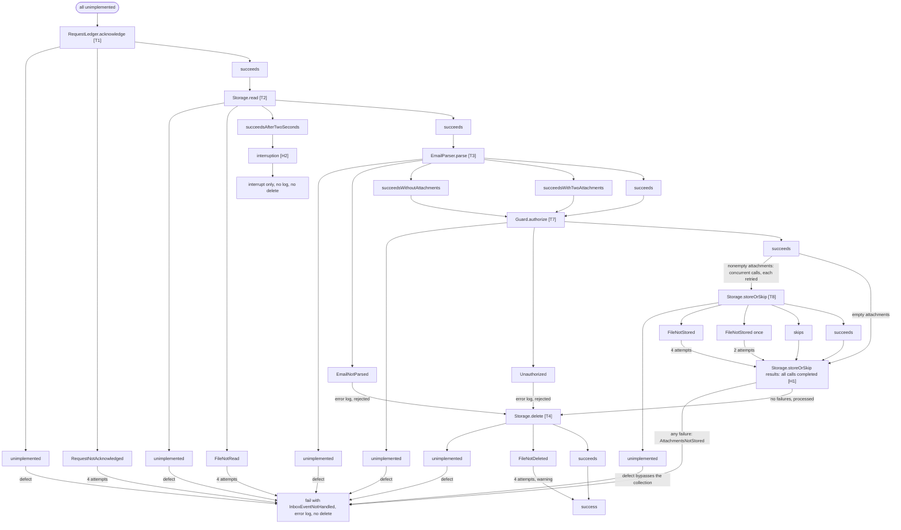

# HandleInbox variant tree

Source: [`handler.ts`](./handler.ts) · Tests: [`handler.test.ts`](./handler.test.ts) · Harness: [`handler.test.helpers.ts`](./handler.test.helpers.ts)

`[Tn]` is the first testing stage for that context, not execution order. Arrows are continuations in the handler.

Rules that apply to every case:

- **Acknowledgement.** `RequestLedger.acknowledge` is the first step. It enters the request in the ledger with `inboxStatus` `pending`, keyed by the request ID, before the handler reads the email. The harness selects `acknowledge('succeeds')` and `record('succeeds')` unless a case selects otherwise.
- **Progress.** `RequestLedger.record` writes two facts. After `Guard.authorize`, it sets `attachments` to the number of attachments, also when there are none. At the end, it sets `inboxStatus` as soon as the handler knows it: `processed` when every attachment is stored, before the delete; `rejected` after the error log of `EmailNotParsed` or `Unauthorized`, before the delete; and `failed` after the error log of `InboxEventNotHandled`. Only the first end is written, so a later defect of the delete does not change the end. An interrupted handler writes no end.
- **Progress failures.** Each `record` is attempted four times. A `RequestNotRecorded` after the last attempt is logged as a warning, and the result of the handler does not change. A defect of a progress write is also logged as a warning, so a progress write never changes the result of the handler.
- **Keys.** The folder comes from `command.receivedAt`. The request ID comes from `command.key` through `requestIDOfEmail` in `Domain/keys.ts`: the SES message ID that names the email object, or a hash of the location for any other key. So a second delivery of the same email writes the same keys, and the command cannot carry an ID that disagrees with its key. `sourceKey` writes the attachment keys. Each attachment key starts with the 1-based position of the attachment in the email, such as `01-lead`.
- **Store or skip.** `Storage.storeOrSkip` writes an attachment only if its key is empty. A key that an earlier run stored is `skipped`, which counts as success. So a redrive or a duplicate S3 event sends no second event to the lead-sources queue.
- **Retries.** The harness moves the TestClock until the handler ends, so a retry waits on that clock. The harness sets `LEAD_PROCESSING_RETRY` to 3, so a typed failure of `acknowledge`, `read`, `storeOrSkip`, or `delete` is attempted four times. `EmailNotParsed`, `Unauthorized`, and defects are not retried.
- **Failures.** `RequestNotAcknowledged`, `FileNotRead`, `AttachmentsNotStored`, and every defect become `InboxEventNotHandled`. The handler logs it as an error and fails with it, so the email stays in the inbox and the message goes to the DLQ for a redrive. The DLQ message does not carry the reason, so the log is the only record of it.
- **Handler outcome.** [`outcome.ts`](../../outcome.ts) gives the ends, the delete, the wrap, and the logs above, and [`outcome.test.ts`](../../outcome.test.ts) covers each of its rules once: a defect of the work or of the delete, and no second end after a defect of the delete. So the cases below check a defect only where the handler decides something: a defect of the parser or of the guard is a failure, not a rejection, and a store defect escapes the partition.
- **Rejected.** Only `Unauthorized` and `EmailNotParsed` delete the email. A redrive cannot parse the same email, so the handler does not keep it. The handler logs the failure as an error, then calls `Storage.delete`, and succeeds. `FileNotDeleted` is logged as a warning.
- **Authorization.** `Guard.authorize` gets the whole parsed email. `GuardLive` fails with `Unauthorized` and one of these reasons, checked in this order: `Email has more than one From header`, `Email has no sender`, `Sender is outside the whitelist`, `Email is not authenticated by SES` (the topmost `Authentication-Results` header is missing, is not from `amazonses.com`, or has no readable `dmarc` result), `DMARC did not pass for <domain>`, and `DMARC passed for <domain>, not for <sender domain>`. The handler treats every reason the same way, so the mock covers them with the single `failsWithUnauthorized` variant. [`Guard/live.test.ts`](../../../../../Infrastructure/Pipeline/Guard/live.test.ts) covers each reason, and [`handler.integration.test.ts`](./handler.integration.test.ts) covers the unauthenticated and the two-From cases with the real parser and guard.
- **Delete.** After every attachment is stored, the handler deletes the email with `Storage.delete`, because the ledger keeps the status of the request. It is the same delete as for a rejected email. `FileNotDeleted` is logged as a warning, and the handler still succeeds.
- **File size.** After `Storage.read`, the handler logs the size of the email (`kind: email`, the length of the body) as `File size of request <id>: {json}` at the level Info. The log comes before the parse, so a rejected email also has a size. The size is not written to the ledger.
- **Interruption.** An interrupt is not an error, so it is not logged and not wrapped.

## Case index

`HI` means `HandleInbox`. Case IDs stay with their earlier behavior. `HI-T1-U`, `HI-T2-U`, `HI-T3-U`, and `HI-T9-U` are gone, because `outcome.test.ts` covers their rules. `HI-T4-E` covers `Storage.delete` on the processed path. It succeeds in every later case that ends. `HI-T9-E` and `HI-T7-E` cover `Storage.delete` on the `Unauthorized` path. `HI-T6-E1` covers it on the `EmailNotParsed` path.

| Stage      | Cases                    | Covers                                                                                                                                                                             |
| ---------- | ------------------------ | ---------------------------------------------------------------------------------------------------------------------------------------------------------------------------------- |
| T1         | HI-T1-E                  | `RequestLedger.acknowledge` `RequestNotAcknowledged`: four attempts, failing `InboxEventNotHandled`, error log, no read, no delete                                                 |
| T2         | HI-T5-E                  | `Storage.read` `FileNotRead`: four attempts, failing `InboxEventNotHandled`, error log, no delete                                                                                  |
| H2         | HI-H2-interrupted        | `read` `succeedsAfterTwoSeconds` interrupted at 1s: the interrupt only, no log, no delete                                                                                          |
| T3         | HI-T6-U                  | `EmailParser.parse` unimplemented: failing `InboxEventNotHandled` with the defect, error log, no delete                                                                            |
| T3         | HI-T6-E1                 | `EmailNotParsed`: one attempt, error log, the inbox object deleted, success                                                                                                        |
| T4         | HI-T4-E                  | no attachments, then `Storage.delete` `FileNotDeleted`: four attempts, warning, success                                                                                            |
| H1         | HI-H1-empty              | `succeedsWithoutAttachments`: no `storeOrSkip` calls, the email deleted                                                                                                            |
| H1         | HI-H1-one-of-two         | `succeedsWithTwoAttachments` with `failsWithFileNotStoredForBroken`: `01-lead` stored once, `02-broken` attempted four times, failing `InboxEventNotHandled`, error log, no delete |
| T7         | HI-T7-U                  | `Guard.authorize` unimplemented: failing `InboxEventNotHandled` with the defect, error log, nothing stored, no delete                                                              |
| T7         | HI-T7-E                  | `Unauthorized` for any reason: error log, the inbox object deleted, success                                                                                                        |
| T4         | HI-T9-E                  | `Unauthorized`, then `Storage.delete` `FileNotDeleted`: four attempts, warning, success                                                                                            |
| T8         | HI-T8-U                  | `Storage.storeOrSkip` unimplemented: the defect escapes the partition, failing `InboxEventNotHandled`, error log, no delete                                                        |
| H1         | HI-H1-one-failure        | `Storage.storeOrSkip` `FileNotStored` on the single attachment: four attempts, failing `InboxEventNotHandled`, error log, no delete                                                |
| H1         | HI-H1-skipped            | `Storage.storeOrSkip` `skips`: the attachment that an earlier run stored is kept, the email deleted, success                                                                       |
| H1         | HI-H1-retried            | `Storage.storeOrSkip` `failsWithFileNotStoredOnce`: two attempts, the email deleted, success                                                                                       |
| Completion | HI-OK                    | attachment stored once, the email deleted                                                                                                                                          |
| Completion | HI-OK-received-at        | two runs with the same `receivedAt` store under the same folder                                                                                                                    |
| Progress   | HI-P-not-recorded        | `record` `failsWithRequestNotRecorded` on the HI-OK path: four attempts for `attachments` and for `processed`, two warnings, success                                               |
| Progress   | HI-P-failed-not-recorded | `record` `failsWithRequestNotRecorded` on the HI-T5-E path: four attempts for `failed`, one warning, the same failing `InboxEventNotHandled`                                       |
| File size  | HI-F-size                | `EmailNotParsed` path: the `File size of request` log with 117 bytes, also for a rejected email |

`HI-H1-empty` and `HI-H1-one-of-two` select `Guard.authorize('succeeds')`. Authorization variants are covered once, on regular parse success. Empty attachments bypass `Storage.storeOrSkip`. `failsWithFileNotStoredForBroken` fails for a key that ends with `-broken` and succeeds for every other key. H1 evaluates the collected results after every call that is not a defect finishes. A store defect does not enter that collection.

H2 interrupts the handler once, during `read`. The exit contains only the interrupt.

The cases check the `record` calls for each end: `processed` in HI-OK, HI-H1-empty (`attachments` 0), and HI-T4-E; `rejected` in HI-T6-E1 and HI-T7-E; `failed` in HI-T1-E, HI-T5-E, and HI-H1-one-of-two; no end in HI-H2-interrupted.
