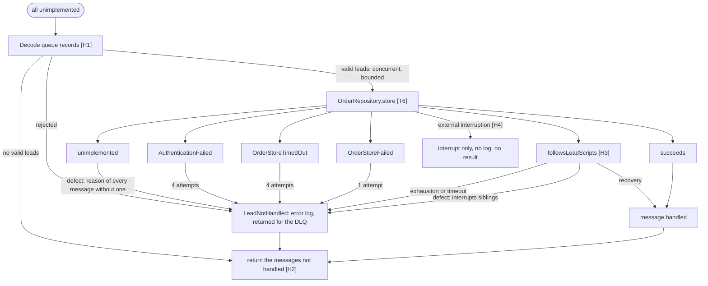

# HandleLead variant tree

Source: [`handler.ts`](./handler.ts) · Command: [`command.ts`](./command.ts) · Tests: [`handler.test.ts`](./handler.test.ts) · Harness: [`handler.test.helpers.ts`](./handler.test.helpers.ts) · Repository variants: [`OrderRepository/mock/variants.ts`](../../../../../Infrastructure/Pipeline/OrderRepository/mock/variants.ts)

The handler takes a batch of queued records and returns one `LeadNotHandled` for each message that it did not handle. The Lambda entrypoint returns those message IDs as `batchItemFailures`, so SQS sends them to the DLQ and acknowledges the others. `[Tn]` and `[Hn]` mark testing stages, not execution order. Arrows are continuations in the handler.

Rules that apply to every case:

- **Failures.** A rejected record, a store that still fails after its retries, a store that times out, and a store that a defect stops all become `LeadNotHandled` with the message ID and the reason. The handler logs each one as an error and returns it. The DLQ message does not carry the reason, so the log is the only record of it.
- **Rejected records.** A record with malformed JSON or an invalid lead is not acknowledged. It goes to the DLQ like a failed store, so a redrive can retry it after a fix.
- **Retries.** The harness sets `LEAD_PROCESSING_RETRY` to 3 and `LEAD_PROCESSING_RETRY_DELAY` to 100ms, and it removes the jitter, so the waits are 100ms, 200ms, and 400ms. `AuthenticationFailed` and `OrderStoreTimedOut` are attempted four times. `OrderStoreFailed` is attempted once. The per-lead timeout of 5s covers all attempts of one lead and the waits between them.
- **Defects.** A defect interrupts the stores that still run. Each message that has no reason of its own takes the defect as its reason. A stored lead stays handled.
- **Redrive.** The order repository stores each idempotency key only once, so a redrive of a lead that an earlier run stored makes no second order.
- **Repeated message IDs.** The decoder builds a map, so the last valid record with an ID replaces the earlier records with that ID.
- **Request ID.** The decoder reads the request ID from the body of each record, next to the lead, with the codec of `Domain/queuedLead.ts` that also writes the body. A record without a request ID is a rejected record. The command has no request ID of its own, because one batch holds the leads of many requests.
- **Progress.** The handler groups the decoded leads by request ID. Before the stores, `RequestLedger.record` adds the number of leads of each request to `leadsPending`. After the stores, one write for each request moves the same number from `leadsPending` to `leadsProcessed` for the stored leads and to `leadsFailed` for the leads not handled. Rejected records are not counted. An interrupted handler writes no end. The harness selects `record('succeeds')` unless a case selects otherwise.
- **Progress failures.** Each `record` is attempted four times. A `RequestNotRecorded` after the last attempt is logged as a warning, and the result of the handler does not change. A defect of a progress write is also logged as a warning, so a progress write never stops the stores.
- **Interruption.** An external interrupt is not an error. The handler does not log it and does not return a result. The entrypoint rejects, so SQS sends the whole batch to the DLQ.

## Case index

`HL` means `HandleLead`. Case IDs stay with their earlier behavior. The store cases keep their `T6` stage from an older suite.

| Stage | Cases | Covers |
| --- | --- | --- |
| T6 | HL-T6-U | `OrderRepository.store` unimplemented: `message-0` with the defect, error log |
| H2 | HL-H2-empty | no records: no store calls, no messages returned, no logs |
| H1 | HL-H1-all-rejected | malformed JSON and an invalid lead: both message IDs with their schema errors, no store calls |
| T6 | HL-T6-E1, HL-T6-E2, HL-T6-E3 | `AuthenticationFailed` / `OrderStoreTimedOut`: four attempts / `OrderStoreFailed`: one attempt; `message-0` with the final error |
| H2 | HL-H2-one-of-two | Broken before Acme: both attempted, Acme stored, only Broken returned |
| H3 | HL-H3-retry-recovers | Flaky: two timed failures, success at 3.3s, nothing returned |
| H3 | HL-H3-retries-exhausted | Exhausted: four `AuthenticationFailed`, the last at 4.7s, returned with the final error |
| H3 | HL-H3-timeout-mid-wait | Exhausted with a delay of 500ms: attempts at 0s, 1.5s, 3.5s, the timeout at 5s comes during the third wait, returned with `TimeoutError` |
| H3 | HL-H3-timeout-mid-retry | Stalled: attempts at 0s, 2.1s, 4.3s, the third interrupted at 5s, returned with `TimeoutError` |
| H3 | HL-H3-concurrency-and-timeout | Slow, Hanging, Acme: two slots, Acme starts at 2s, Hanging returned with `TimeoutError` at 5s |
| H3 | HL-H3-defect-interrupts | Acme, Crashing, Slow: Acme stored, Crashing dies at 1s, Slow interrupted, both returned with the defect |
| H4 | HL-H4-interrupted | Slow interrupted at 1s from outside: the interrupt only, no logs |
| H1 | HL-H1-rejected | a valid record and an empty, a malformed, and an invalid record: Acme stored, the three rejected IDs returned |
| H5 | HL-H5-duplicate-id | First and Last share an ID: only Last stored, nothing returned |
| Completion | HL-OK | Acme and Beta stored once each, nothing returned, no logs |
| Progress | HL-P-no-request-id | a record with a lead but no request ID: returned as rejected, not counted; Acme counted and processed |
| Progress | HL-P-one-write-per-request | ten leads of one request: ten stores, but only one start and one end write |
| Progress | HL-P-many-requests | three leads of two requests: one start and one end for each request, with only its own leads |
| Progress | HL-P-record-defect | `record` unimplemented: both leads stored, nothing returned, the defects of the start and of the end logged as warnings |
| Progress | HL-P-not-recorded | `record` `failsWithRequestNotRecorded`: four attempts for the start and for the end, two warnings, both leads stored, nothing returned |

Every case checks that the returned list and the error log hold the same `LeadNotHandled` values, and that no warning is logged, except HL-P-not-recorded and HL-P-record-defect. The cases check the `record` calls for stored and not handled leads (HL-OK, HL-H2-one-of-two, HL-H3-defect-interrupts, HL-T6-U), for no counted lead (HL-H2-empty, HL-H1-all-rejected), and for no end (HL-H4-interrupted). Scripted attempts of `followsLeadScripts` are keyed by lead name, so no case depends on call order.

## Integration coverage

The handler integration suite has five cases: consumption of the two messages that HandleLeadSources sends, a valid record next to a rejected record, malformed JSON, a JSON object without a lead, and a partial batch failure that a second run recovers. In every case the returned `LeadNotHandled` values are also the logged errors. The pipeline integration suite runs the same handler for the full email, the invalid sibling workbook, and the partial order failure. The deployed e2e suite covers the Lambda partial batch response and the Leads DLQ.
