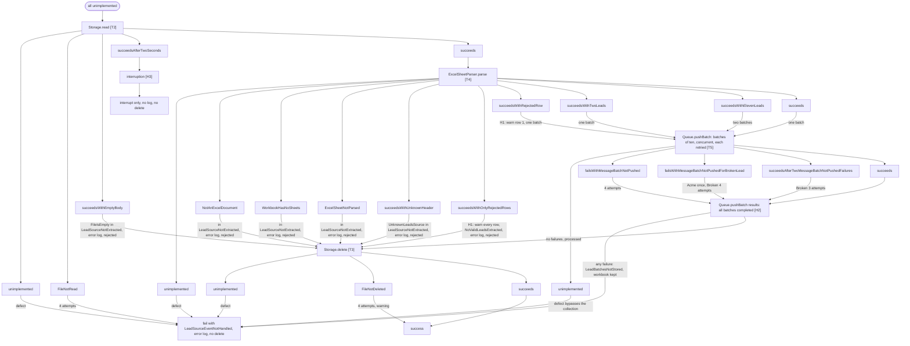

# HandleLeadSources variant tree

Source: [`handler.ts`](./handler.ts) · Tests: [`handler.test.ts`](./handler.test.ts) · Harness: [`handler.test.helpers.ts`](./handler.test.helpers.ts) · Parser variants: [`ExcelSheetParser/mock/variants.ts`](../../../../../Infrastructure/Pipeline/ExcelSheetParser/mock/variants.ts)

`[Tn]` is the first testing stage for that context, not execution order. Arrows are continuations in the handler.

Rules that apply to every case:

- **Keys.** The request ID comes from `command.key` through `originOfSource` in `Domain/keys.ts`: the folder of the email that the inbox handler wrote the workbook into. So the source counts in the entry of its email, and a second delivery of the same workbook counts in the same entry. A key outside the folder of an email, such as a manual upload, is a standalone request with a hash of its location as the ID. The handler logs a warning for it and then handles it as any other source.
- **Retries.** The harness moves the TestClock until the handler ends, so a retry waits on that clock. The harness sets `LEAD_PROCESSING_RETRY` to 3, so a typed failure of `read`, `pushBatch`, or `delete` is attempted four times. Each `pushBatch` retry sends only the messages that the queue did not accept. Extraction errors and defects are not retried.
- **Failures.** `FileNotRead`, `LeadBatchesNotStored`, and every defect become `LeadSourceEventNotHandled`. The handler logs it as an error and fails with it, so the workbook stays in the bucket and the message goes to the DLQ for a redrive. The DLQ message does not carry the reason, so the log is the only record of it.
- **Handler outcome.** [`outcome.ts`](../../outcome.ts) gives the ends, the delete, the wrap, and the logs above, and [`outcome.test.ts`](../../outcome.test.ts) covers each of its rules once: a defect of the work or of the delete, and no second end after a defect of the delete. So the cases below check a defect only where the handler decides something: a defect of the parser is a failure, not a rejection, and a push defect escapes the partition.
- **Redrive.** A redrive pushes every lead of the workbook again. The order repository stores each idempotency key only once, so a lead that an earlier run pushed makes no second order.
- **Rejected rows.** A rejected row is logged as a warning. The valid rows continue. A workbook with no valid rows is rejected with `NoValidLeadsExtracted`.
- **Rejected.** Only `LeadSourceNotExtracted` and `NoValidLeadsExtracted` reject the workbook. A redrive cannot extract leads from the same workbook, so the handler does not keep it. The handler logs the rejection as an error, then deletes the workbook, and succeeds.
- **Delete.** After every lead is pushed, the handler deletes the workbook with `Storage.delete`, because the ledger keeps the status of the request. It is the same delete as for a rejected workbook. `FileNotDeleted` is logged as a warning, and the handler still succeeds.
- **Interruption.** An interrupt is not an error, so it is not logged and not wrapped.
- **File size.** After `Storage.read`, the handler logs the size of the source (`kind: source`, the length of the body) as `File size of request <id>: {json}` at the level Info. The source handler logs it, not the inbox, so a standalone source also has a size. The size is not written to the ledger.
- **Progress.** `RequestLedger.record` writes three facts for the request ID. At the start, `sourceStarted` adds 1 to `sourcesPending`. After the extraction and before the first push, `sourceFoundLeads` adds the number of valid leads to `sourcesLeads`. At the end, as soon as the handler knows it, `sourceEnded` moves the source from `sourcesPending` to `sourcesProcessed` when every lead is pushed, before the delete; to `sourcesRejected` after the error log of `LeadSourceNotExtracted` or `NoValidLeadsExtracted`, before the delete; or to `sourcesFailed` after the error log of `LeadSourceEventNotHandled`. A failed end for `LeadBatchesNotStored` also adds its leads that were not pushed to `leadsFailed`. Only the first end is written, so a later defect of the delete does not count the source two times. An interrupted handler writes no end. Rejected rows are not counted. The harness selects `record('succeeds')` unless a case selects otherwise.
- **Progress failures.** Each `record` is attempted four times. A `RequestNotRecorded` after the last attempt is logged as a warning, and the result of the handler does not change. A defect of a progress write is also logged as a warning, so a progress write never changes the result of the handler.

## Case index

`HLS` means `HandleLeadSources`. Case IDs stay with their earlier behavior. The `Clock` port is gone, so `HLS-T1-U` is gone too. `HLS-T2-U`, `HLS-T3-U`, and `HLS-T6-U` are gone, because `outcome.test.ts` covers their rules. `HLS-T3-E` covers `Storage.delete` on the rejected path, and `HLS-T7-E` on the processed path. It succeeds in every later case that ends.

| Stage | Cases | Covers |
| --- | --- | --- |
| T2 | HLS-T2-E | `Storage.read` `FileNotRead`: four attempts, failing `LeadSourceEventNotHandled`, error log, no delete |
| T3 | HLS-T3-E | `succeedsWithEmptyBody`, then `Storage.delete` `FileNotDeleted`: four attempts, warning, success |
| H1 | HLS-H1-empty-body | `read` `succeedsWithEmptyBody`: `FileIsEmpty` in `LeadSourceNotExtracted`, parser not called, error log, the workbook deleted, success |
| H3 | HLS-H3-interrupted | `read` `succeedsAfterTwoSeconds` interrupted at 1s: the interrupt only, no log, no delete |
| T4 | HLS-T4-U | `ExcelSheetParser.parse` unimplemented: failing `LeadSourceEventNotHandled` with the defect, error log, no delete |
| T4 | HLS-T4-E1, HLS-T4-E2, HLS-T4-E3 | `NotAnExcelDocument` / `WorkbookHasNoSheets` / `ExcelSheetNotParsed`: in `LeadSourceNotExtracted`, error log, the workbook deleted, success |
| H1 | HLS-H1-unknown-source | `succeedsWithUnknownHeader`: `UnknownLeadsSource` in `LeadSourceNotExtracted`, error log, the workbook deleted, success |
| H1 | HLS-H1-all-rejected | `succeedsWithOnlyRejectedRows`: warning for rows 0 and 1, `NoValidLeadsExtracted`, no push, the workbook deleted, success |
| T5 | HLS-T5-U | `Queue.pushBatch` unimplemented: warning for row 1, failing `LeadSourceEventNotHandled` with the defect, no delete |
| T5 | HLS-T5-E | `failsWithMessageBatchNotPushed`: four attempts, `LeadBatchesNotStored` for Acme, failing, no delete |
| T3 | HLS-T7-E | leads pushed, then `Storage.delete` `FileNotDeleted`: four attempts, warning, success |
| H1 | HLS-H1-rejected | `succeedsWithRejectedRow`: warning for row 1, one batch with Acme, the workbook deleted |
| H2 | HLS-H2-one-of-two | `succeedsWithTwoLeads` with `failsWithMessageBatchNotPushedForBrokenLead`: Acme once, Broken four times, `LeadBatchesNotStored` for Broken only, failing, no delete |
| H4 | HLS-H4-recovered | `succeedsAfterTwoMessageBatchNotPushedFailures`: Broken three times, no warning, the workbook deleted |
| H2 | HLS-H2-batches | `succeedsWithElevenLeads`: batches of 10 and 1, the workbook deleted |
| Completion | HLS-OK | one batch with the complete Acme message, the workbook deleted |
| Progress | HLS-P-not-recorded | `record` `failsWithRequestNotRecorded` on the HLS-OK path: four attempts for each of the three writes, three warnings, success |
| Progress | HLS-P-failed-not-recorded | `record` `failsWithRequestNotRecorded` on the HLS-T5-E path: four attempts for each write, three warnings, the same failing `LeadSourceEventNotHandled` |
| Keys | HLS-K-standalone | a key outside the folder of an email on the HLS-OK path: one warning, every write and push under the hash of the location, the workbook deleted, success |
| File size | HLS-F-size | the HLS-OK path: the `File size of request` log with 117 bytes |
| File size | HLS-F-standalone-size | the HLS-K-standalone path: the `File size of request` log under the hash of the location |

`failsWithMessageBatchNotPushedForBrokenLead` fails only for the lead named `Broken`, so the outcome does not depend on the order of concurrent calls. H2 evaluates the collected results after every call that is not a defect finishes. A push defect does not enter that collection. The HLS-T4 errors come from `describe.each`.

The cases check the `record` calls for each end: `processed` in HLS-OK, HLS-H1-rejected, and HLS-T7-E; `rejected` in HLS-H1-empty-body, HLS-T4-E1 to HLS-T4-E3, and HLS-H1-all-rejected (no `sourcesLeads` write); `failed` in HLS-T2-E; `failed` with leads not pushed in HLS-T5-E and HLS-H2-one-of-two; no end in HLS-H3-interrupted.

Not covered by decision: the order of many failures inside `LeadBatchesNotStored`, a defect that races a collected typed failure, and interruption during `parse` or `pushBatch` (same region and handling as the covered interruption at `read`).
